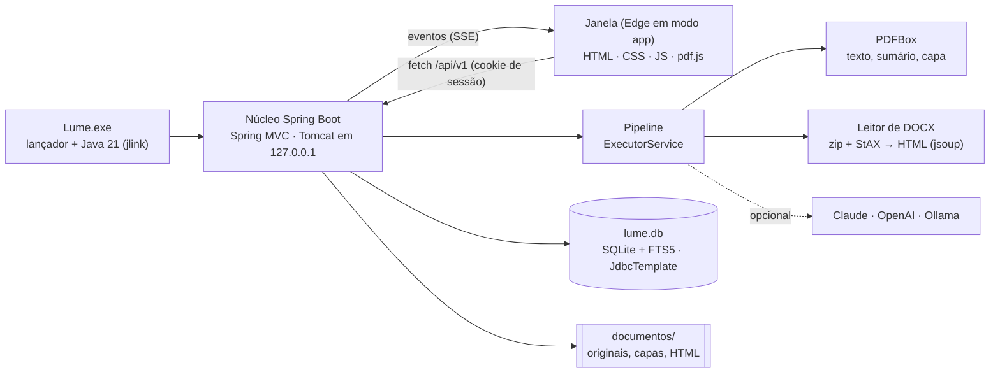

<p align="center">
  
</p>

<h1 align="center">Lume para Windows<br><sub><sup><sup><sub>Copyright (©) 2026 Erik Pimenta & Clara Portes</sub></sup></sup></sub></h1>

<p align="center">
  Biblioteca de PDFs e DOCX que roda inteira no seu computador: você arrasta os arquivos (ou pastas inteiras), o Lume gera as capas, escreve uma descrição de cada documento com IA e abre tudo num leitor próprio que lembra onde você parou.<br>
  Um único <code>Lume.exe</code>, sem instalador, sem servidor na nuvem e sem conta.
</p>

<p align="center">
  Java 21 · Spring Boot 4 · Spring MVC + Tomcat · JdbcTemplate · SQLite + FTS5 · Apache PDFBox · jsoup · JNA · JUnit 6 · HTML/CSS/JS · pdf.js 5 · Playwright
</p>

---

> **Baixar e usar:** pegue o [Lume.exe](https://github.com/ravelroot/Document-Library-Desktop/blob/main/Lume.exe) (cerca de 46 MB, Windows 10/11 de 64 bits, já com o Java embutido) e dê dois cliques. Na primeira vez ele leva alguns segundos preparando os arquivos. Se o Windows mostrar *O Windows protegeu o computador*, clique em **Mais informações → Executar assim mesmo** (o executável não tem assinatura digital paga).

> **Manual completo:** [`Manual-Lume-Desktop.pdf`](Manual-Lume-Desktop.pdf) explica a instalação, o modo portátil, cada tela, o leitor, a descrição por IA, a arquitetura em Java, a API local, o desenvolvimento e a solução de problemas, passo a passo.

> **Banco de dados:** [`Banco-de-Dados-Lume-Desktop.pdf`](Banco-de-Dados-Lume-Desktop.pdf) traz o diagrama de relacionamentos, o dicionário de dados, o ciclo de vida dos documentos, a busca em texto completo com FTS5, as regras de integridade, consultas prontas, backup e como evoluir o esquema.

> **Versão web:** o Lume também roda no navegador, veja [Document-Library-Platform](https://github.com/Violet-pixel/Document-Library-Platform).

<p align="center">
  
</p>

## O que o Lume faz

- **Arraste e pronto:** solte PDFs, DOCX ou pastas inteiras na janela, ou use **Adicionar documentos → Importar uma pasta inteira**. A bandeja mostra cada etapa ao vivo: copiando, na fila, lendo o documento, escrevendo a descrição, pronto. O mesmo arquivo nunca entra duas vezes (impressão digital SHA-256).
- **Capas automáticas:** a primeira página útil de cada PDF vira capa (Apache PDFBox). DOCX ganha uma capa tipográfica desenhada em Java2D nas cores da paleta, a mesma da versão web: Creme, Camurça, Sálvia, Ardósia e Rosé.
- **Descrição por IA ao passar o mouse:** duas ou três frases e etiquetas sugeridas para cada documento. Funciona sem internet (resumo extrativo local, em Java) ou com Claude, OpenAI, Ollama, LM Studio e qualquer API compatível. A chave fica cifrada pelo cofre do Windows (DPAPI).
- **Leitor próprio:** PDF com pdf.js (zoom, miniaturas, sumário, busca, temas papel, sépia e noite, modo foco) e DOCX convertido em texto de leitura. Destaques em quatro cores, notas e marcadores, exportáveis em Markdown. O progresso fica salvo.
- **Organização:** estantes (quero ler, lendo, lidos) com arrastar e soltar, coleções com ordem própria, favoritos e etiquetas.
- **Busca de verdade:** título, autor, descrições, etiquetas e o texto inteiro, sem diferenciar acentos, com frase exata, exclusão (`-palavra`) e o trecho encontrado em destaque.
- **Do jeito do Windows:** diálogos nativos, abrir no programa padrão, mostrar no Explorador, salvar uma cópia, "Abrir com" o Lume num PDF, tema que acompanha o sistema e **modo portátil** para levar a biblioteca num pendrive.

<p align="center">
  
</p>

## Onde ficam os dados

| Situação | Pasta |
| --- | --- |
| Padrão | `%APPDATA%\Lume\Biblioteca` (a mesma da versão 1.x, então a biblioteca antiga abre direto) |
| Modo portátil | `Lume-dados\Biblioteca`, ao lado do `Lume.exe` (crie a pasta `Lume-dados` antes de abrir) |
| Escolhida | o caminho da variável `LUME_DATA_DIR` |

A pasta guarda o banco `lume.db` (SQLite), o registro `lume.log` e uma cópia de cada documento importado, com a capa e o HTML de leitura. Os arquivos originais nunca são alterados. Para fazer backup, feche o Lume e copie a pasta inteira.

Para experimentar, arraste a pasta [`exemplos/`](exemplos) para a janela: são 12 documentos fictícios (8 PDF e 4 DOCX), os mesmos dos prints.

## Como funciona

<p align="center">
  
  
</p>



É a versão desktop do [Lume Web](https://github.com/Violet-pixel/Document-Library-Platform), agora com o núcleo em **Java 21 + Spring Boot 4**: a mesma interface e as mesmas regras, com o Django virando controladores Spring MVC, o WebSocket virando Server-Sent Events, o PostgreSQL e o Redis dando lugar ao SQLite (JdbcTemplate) e a uma fila em memória com `ExecutorService`, e o processador Java (PDFBox) de volta ao centro, lendo PDFs e desenhando as capas. A janela é o Microsoft Edge em modo aplicativo (o mesmo Chromium que vinha no Electron, já presente no Windows 10/11), com perfil próprio e sem barra de endereço.

O servidor só atende `127.0.0.1`: a janela entra com uma chave de uso único e recebe um cookie de sessão (HttpOnly, SameSite=Strict); sem ele, a API responde 401. O Host e a origem dos pedidos são conferidos.

| Etapa | O que acontece |
| --- | --- |
| Importação | Cópia para a biblioteca com SHA-256, tipo conferido pelo conteúdo, documento criado como *na fila* |
| Leitura | PDF: texto por página, sumário, metadados e capa (PDFBox). DOCX: HTML de leitura higienizado (jsoup), imagens, sumário e capa tipográfica |
| Descrição | Resumo e etiquetas pelo provedor escolhido; se ele falhar, o resumo local assume e o motivo fica registrado |
| Pronto | Índice de busca atualizado e a tela muda sozinha |

Falhas passageiras tentam de novo (5 s, 15 s, 45 s); arquivos protegidos por senha ou corrompidos falham na hora com a explicação. O que ficou pela metade quando o Lume foi fechado volta para a fila na próxima abertura.

### Como contribuir

1. Abra uma issue descrevendo a ideia ou o problema.
2. Crie uma branch a partir da `main` e envie um pull request.
3. Quando a mudança for feita em dupla, inclua a linha `Co-authored-by:` no commit para que as duas pessoas recebam o crédito.

## Desenvolvimento

Requisitos: JDK 21, Maven 3.9 e Git (Node.js 22+ só para o teste de interface; NSIS só para gerar o `.exe`).

```bash
git clone https://github.com/ravelroot/Document-Library-Desktop.git
cd Document-Library-Desktop
mvn test                                  # 37 testes JUnit (banco, busca, pipeline, API, DOCX, PDF, IA...)
mvn spring-boot:run                       # abre o Lume a partir do código
mvn spring-boot:run -Dspring-boot.run.arguments=--sem-janela   # só o servidor (mostra o endereço de entrada)
mvn -q package dependency:copy-dependencies -DincludeScope=runtime -DoutputDirectory=target/lib
npm --prefix e2e install && npm --prefix e2e test               # abre a interface no Chromium e percorre todas as telas
bash scripts/empacotar-windows.sh         # gera o Lume.exe portátil (jlink + NSIS) e copia para a raiz
```

### Estrutura

```text
Lume.exe                         executável portátil para Windows (Java embutido)
pom.xml                          Maven: Spring Boot 4, PDFBox, sqlite-jdbc, jsoup, JNA
src/main/java/io/github/ravelroot/lume/
  LumeApplication.java           início: pasta de dados, instância única, servidor e janela
  core/  db/  events/            utilitários, SQLite + migrações, eventos
  library/  pipeline/            biblioteca, busca FTS5, coleções, anotações, fila de processamento
  processing/  docx/  ai/        PDFBox e capas, leitor de DOCX, descrição por IA
  web/  desktop/                 API REST, SSE, sessão; janela, diálogos e integração com o Windows
src/main/resources/static/       interface (módulos ES, sem build), pdf.js 5, fontes e ícones
src/test/java/                   JUnit 6 + Spring Boot Test
e2e/                             teste de interface com Playwright
packaging/windows/  scripts/     lançador NSIS e empacotamento (jlink)
exemplos/                        12 documentos fictícios
docs/                            manuais em PDF e imagens do README
.github/workflows/               CI (testes, interface e Lume.exe) e atividade diária
```

## Parceria

O Lume é um projeto desenvolvido em parceria por Erik Pimenta ([@ravelroot](https://github.com/ravelroot)) e Clara Portes ([@Violet-pixel](https://github.com/Violet-pixel)).

A ideia surgiu da vontade de ter um lugar único para organizar, ler e anotar documentos, sem depender de vários aplicativos diferentes. Desde o início, o projeto foi pensado e construído a quatro mãos: das decisões de arquitetura e do pipeline de ingestão até o design do leitor e a identidade visual.

O repositório oficial fica na conta da Clara, em [Violet-pixel/Document-Library-Platform](https://github.com/Violet-pixel/Document-Library-Platform). A versão desktop, [Document-Library-Desktop](https://github.com/ravelroot/Document-Library-Desktop), segue a mesma parceria e reaproveita a base da versão web.

Sugestões, issues e pull requests são bem-vindos nos dois repositórios.

## Licença

Copyright (©) 2026 Erik Pimenta & Clara Portes

Este projeto é distribuído sob a licença [MIT](LICENSE). Você pode usar, copiar, modificar e redistribuir o código, inclusive para fins comerciais, desde que mantenha o aviso de copyright e o texto da licença.

### Componentes de terceiros

O Lume inclui ou depende de componentes com licenças próprias, que continuam valendo para cada um deles:

| Componente | Uso no projeto | Licença |
|---|---|---|
| [Spring Boot](https://spring.io/projects/spring-boot) / Spring Framework | Núcleo, API REST e injeção de dependências | Apache-2.0 |
| [Apache Tomcat](https://tomcat.apache.org/) | Servidor HTTP embutido (127.0.0.1) | Apache-2.0 |
| [Apache PDFBox](https://pdfbox.apache.org/) | Texto, sumário, metadados e capas dos PDFs | Apache-2.0 |
| [SQLite JDBC](https://github.com/xerial/sqlite-jdbc) | Banco local com busca FTS5 | Apache-2.0 |
| [jsoup](https://jsoup.org/) | Lista de permissões do HTML de leitura | MIT |
| [JNA](https://github.com/java-native-access/jna) | Cofre do Windows (DPAPI), registro e foco da janela | Apache-2.0 / LGPL-2.1 |
| [Jackson](https://github.com/FasterXML/jackson) | JSON da API | Apache-2.0 |
| [Eclipse Temurin](https://adoptium.net/) (OpenJDK) | Java embutido no Lume.exe | GPL-2.0 com Classpath Exception |
| [NSIS](https://nsis.sourceforge.io/) | Lançador portátil do Lume.exe | zlib |
| [pdf.js](https://github.com/mozilla/pdf.js) | Renderização de PDF no leitor | Apache-2.0 |
| [Lucide](https://lucide.dev/) | Ícones da interface | ISC |
| [Public Sans](https://public-sans.digital.gov/) | Fonte da interface | SIL Open Font License 1.1 |
| [Literata](https://github.com/googlefonts/literata) | Fonte de leitura e das capas | SIL Open Font License 1.1 |
| [JUnit](https://junit.org/) / [Playwright](https://playwright.dev/) | Testes automatizados | EPL-2.0 / Apache-2.0 |

O Microsoft Edge (WebView2/Chromium) que desenha a janela já vem com o Windows e não é redistribuído pelo Lume.

Os documentos enviados pelos usuários (PDF e DOCX) pertencem aos seus respectivos autores e não são cobertos por esta licença.
