<p align="center">
  
</p>

<h1 align="center">Lume para Windows<br><sub><sup><sup><sub>Copyright (©) 2026 Erik Pimenta & Clara Portes</sub></sup></sup></sub></h1>

<p align="center">
  Biblioteca de PDFs e DOCX que roda inteira no seu computador: você arrasta os arquivos (ou pastas inteiras), o Lume gera as capas, escreve uma descrição de cada documento com IA, responde perguntas sobre o texto e abre tudo num leitor próprio que lembra onde você parou.<br>
  Um único <code>Lume.exe</code>, sem instalador, sem servidor na nuvem e sem conta.
</p>

<p align="center">
  <b>Versão 2.1.0</b> · nova identidade visual · seleção em lote · paleta de comandos · Pergunte ao documento · Estatísticas · Ferramentas · Integrações
</p>

<p align="center">
  Java 21 · Spring Boot 4 · Spring MVC + Tomcat · JdbcTemplate · SQLite + FTS5 · Apache PDFBox · jsoup · JNA · JUnit 6 · HTML/CSS/JS · pdf.js 5 · Playwright
</p>

---

> **Baixar e usar:** pegue o [Lume.exe](https://github.com/ravelroot/Document-Library-Desktop/blob/main/Lume.exe) (versão 2.1.0, cerca de 46 MB, Windows 10/11 de 64 bits, já com o Java embutido) e dê dois cliques. Na primeira vez ele leva alguns segundos preparando os arquivos. Se o Windows mostrar *O Windows protegeu o computador*, clique em **Mais informações → Executar assim mesmo** (o executável não tem assinatura digital paga).

> **Manual completo:** [`Manual-Lume-Desktop.pdf`](Manual-Lume-Desktop.pdf) explica a instalação, o modo portátil, cada tela (incluindo Estatísticas, Ferramentas e Integrações), o leitor, a IA, a arquitetura em Java, a API local, o desenvolvimento e a solução de problemas, passo a passo.

> **Banco de dados:** [`Banco-de-Dados-Lume-Desktop.pdf`](Banco-de-Dados-Lume-Desktop.pdf) traz o diagrama de relacionamentos, o dicionário de dados, o ciclo de vida dos documentos, a busca em texto completo com FTS5, as regras de integridade, as consultas das Estatísticas, backup, manutenção e como evoluir o esquema.

> **Versão web:** o Lume também roda no navegador, veja [Document-Library-Platform](https://github.com/Violet-pixel/Document-Library-Platform).

<p align="center">
  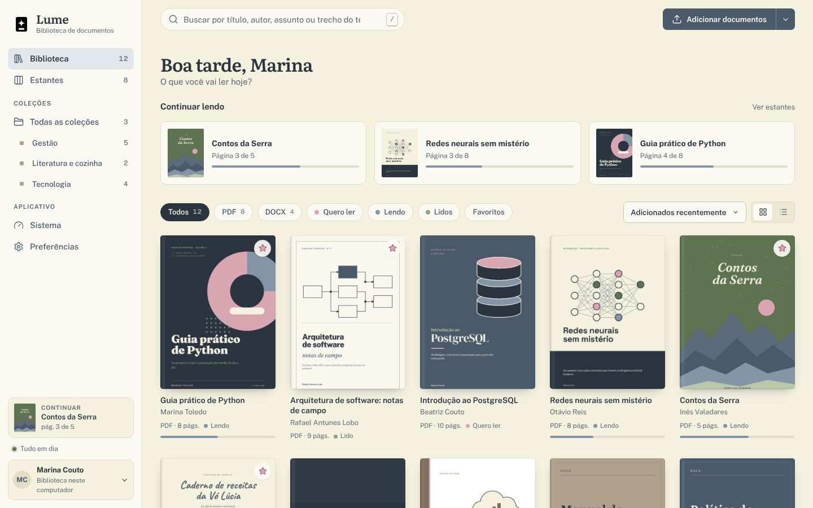
</p>

## Novidades da versão 2.1

| | |
| --- | --- |
| **Nova identidade visual** | A mesma do [Lume Web 1.1](https://github.com/Violet-pixel/Document-Library-Platform): Creme como mesa, papel de leitura mais claro, tinta escura para o texto e a ação principal, Rosé tinta (`#9C4A5B`) como cor de assinatura, IBM Plex Mono nos rótulos e números, filtros como abas de índice e uma saudação que resume a biblioteca em uma frase. |
| **Seleção em lote** | Botão **Selecionar** (ou tecla `S`, ou Shift+clique): mude a estante, favorite, adicione etiquetas, coloque numa coleção, gere a descrição de novo, exporte ou exclua vários documentos de uma vez. |
| **Paleta de comandos** | `Ctrl+K` abre qualquer tela, executa ações (importar, nova coleção, backup, exportar, tema) e encontra documentos pelo título ou pelo texto. `?` mostra todos os atalhos. |
| **Pergunte ao documento** | Faça uma pergunta na página do documento: sem internet, o Lume devolve os trechos mais relevantes; com um provedor de IA, a resposta vem escrita, sempre com os trechos numerados e o link para a página. |
| **Estatísticas** | Documentos adicionados e leituras concluídas mês a mês, páginas lidas, anotações, assuntos mais frequentes, formatos, idiomas e maiores arquivos. |
| **Ferramentas** | Backup completo em `.zip`, exportação do catálogo (CSV para Excel, JSON, BibTeX para Zotero/Mendeley, Markdown), notas para Obsidian/Notion e manutenção (verificar, reconstruir a busca, otimizar, limpar sobras). |
| **Integrações** | Pastas monitoradas que importam sozinhas (Downloads, OneDrive, Google Drive, Dropbox, scanner) e webhooks para n8n, Make, Zapier, Slack, Discord e Teams. |
| **Mais provedores de IA** | Atalhos prontos para Claude, OpenAI, Google Gemini, Groq, OpenRouter, Mistral, DeepSeek, Ollama e LM Studio. |
| **Parecidos na biblioteca** | Cada documento mostra os que têm assunto em comum. |

<p align="center">
  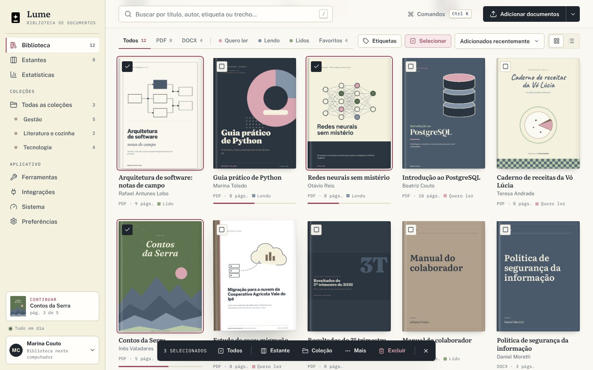
  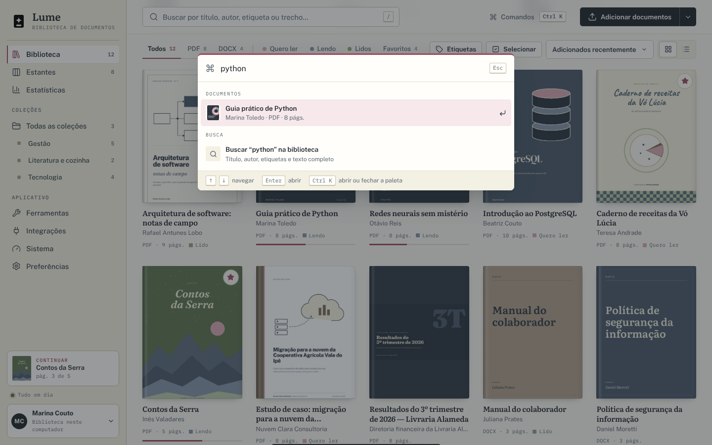
</p>
<p align="center">
  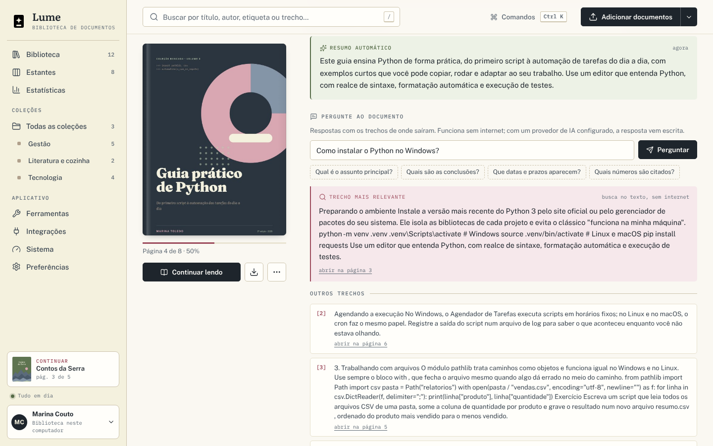
  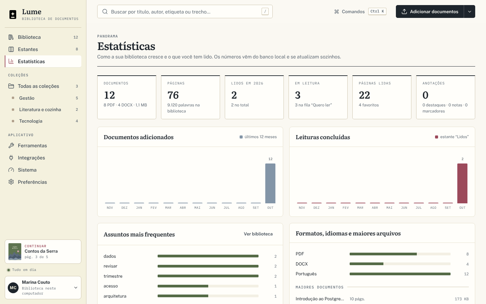
</p>

## O que o Lume faz

- **Arraste e pronto:** solte PDFs, DOCX ou pastas inteiras na janela, ou use **Adicionar documentos → Importar uma pasta inteira**. A bandeja mostra cada etapa ao vivo: copiando, na fila, lendo o documento, escrevendo a descrição, pronto. O mesmo arquivo nunca entra duas vezes (impressão digital SHA-256).
- **Capas automáticas:** a primeira página útil de cada PDF vira capa (Apache PDFBox). DOCX ganha uma capa tipográfica desenhada em Java2D nas cores da paleta, a mesma da versão web: Creme, Camurça, Sálvia, Ardósia e Rosé.
- **Descrição por IA ao passar o mouse:** duas ou três frases e etiquetas sugeridas para cada documento. Funciona sem internet (resumo extrativo local, em Java) ou com Claude, OpenAI, Ollama, LM Studio e qualquer API compatível. A chave fica cifrada pelo cofre do Windows (DPAPI).
- **Leitor próprio:** PDF com pdf.js (zoom, miniaturas, sumário, busca, temas papel, sépia e noite, modo foco) e DOCX convertido em texto de leitura. Destaques em quatro cores, notas e marcadores, exportáveis em Markdown. O progresso fica salvo.
- **Organização:** estantes (quero ler, lendo, lidos) com arrastar e soltar, coleções com ordem própria, favoritos e etiquetas.
- **Busca de verdade:** título, autor, descrições, etiquetas e o texto inteiro, sem diferenciar acentos, com frase exata, exclusão (`-palavra`) e o trecho encontrado em destaque. Filtro por etiqueta e paleta de comandos (`Ctrl+K`).
- **Perguntas sobre o texto:** "Pergunte ao documento" encontra os trechos que respondem à sua pergunta, no próprio computador ou com o provedor de IA escolhido.
- **Trabalho em lote:** selecione vários documentos e mude estante, favoritos, etiquetas e coleções, exporte ou exclua de uma vez.
- **Panorama da leitura:** a tela Estatísticas mostra o que entrou e o que você leu em cada mês, as páginas lidas, as anotações e os assuntos mais frequentes.
- **Do jeito do Windows:** diálogos nativos, abrir no programa padrão, mostrar no Explorador, salvar uma cópia, "Abrir com" o Lume num PDF, tema que acompanha o sistema e **modo portátil** para levar a biblioteca num pendrive.

<p align="center">
  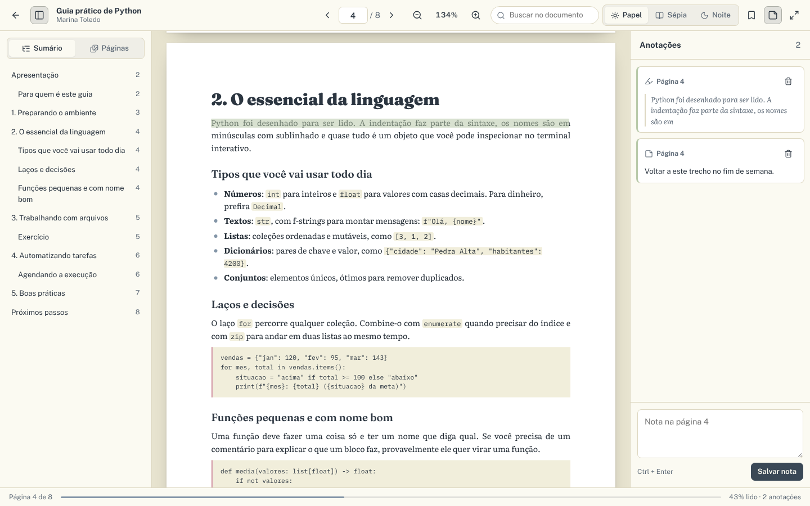
</p>

## Ferramentas e integrações

<p align="center">
  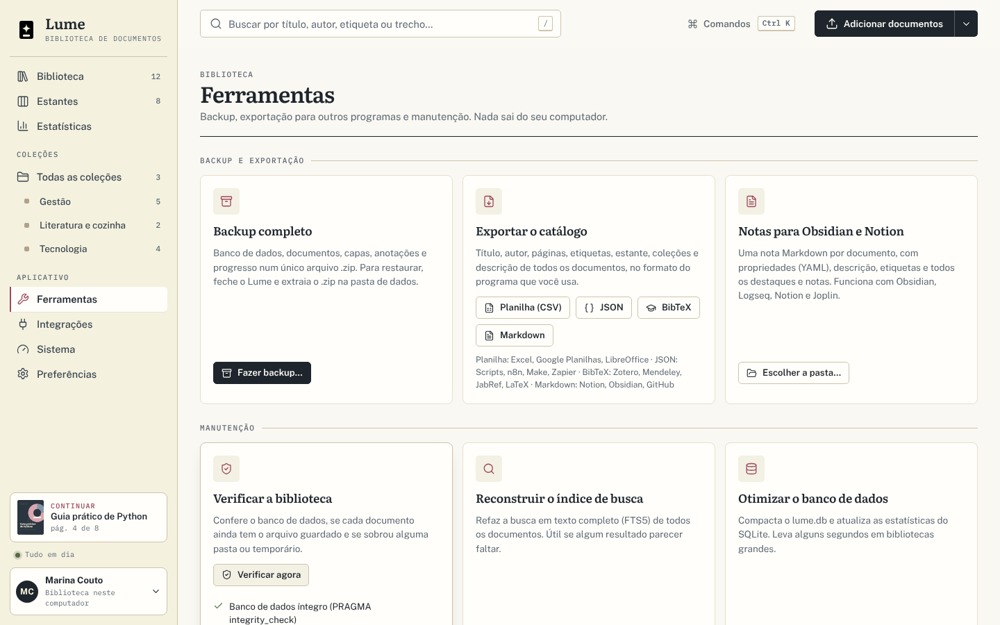
  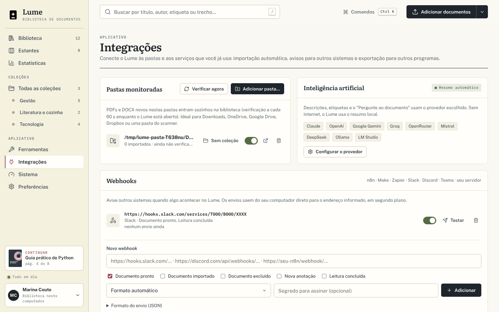
</p>

| Ferramenta | Para quê |
| --- | --- |
| Backup completo | Um `.zip` com o banco (`lume.db`, cópia consistente feita com `VACUUM INTO`), os documentos, as capas e as anotações. Para restaurar, feche o Lume e extraia o `.zip` na pasta de dados. |
| Exportar o catálogo | **CSV** (separado por `;`, abre direto no Excel), **JSON** (scripts, n8n, Make), **BibTeX** (Zotero, Mendeley, JabRef, LaTeX) e **Markdown** (Notion, GitHub). Também exporta só os documentos selecionados. |
| Notas para Obsidian e Notion | Uma nota `.md` por documento, com propriedades em YAML, descrição, etiquetas, destaques e notas. Funciona com Obsidian, Logseq, Notion e Joplin. |
| Manutenção | Verifica o banco (`PRAGMA integrity_check`), os arquivos e as sobras; reconstrói a busca FTS5; otimiza o banco (`VACUUM` + `PRAGMA optimize`); limpa pastas órfãs; gera todas as descrições de novo. |

**Pastas monitoradas.** Em *Integrações*, escolha pastas (Downloads, OneDrive, Google Drive, Dropbox, a pasta do scanner...) e os PDFs e DOCX novos que aparecerem nelas entram sozinhos na biblioteca, a cada 60 segundos enquanto o Lume está aberto, opcionalmente direto numa coleção. Arquivos repetidos são reconhecidos pela impressão digital e não entram duas vezes.

**Webhooks.** O Lume avisa outros sistemas quando um documento fica pronto, é importado ou excluído, quando você cria uma anotação ou termina uma leitura. Slack e Discord recebem uma mensagem pronta; n8n, Make, Zapier, Teams (via fluxo) ou o seu servidor recebem o JSON abaixo. Com um segredo, cada envio leva a assinatura `X-Lume-Signature: sha256=<HMAC-SHA256 do corpo>`.

```json
{
  "event": "document.ready",
  "sent_at": "2026-10-27T13:00:00Z",
  "app": "Lume",
  "document": { "id": "…", "title": "Relatório anual", "author": "…", "kind": "pdf",
                "page_count": 42, "summary": "…", "tags": ["finanças"] }
}
```

**Provedores de IA.** Em *Preferências → Inteligência artificial*, um clique preenche o endereço e um modelo sugerido:

| Provedor | Como conecta | Precisa de internet |
| --- | --- | --- |
| Resumo automático | Extrativo, em Java, no próprio computador | Não |
| Claude (Anthropic) | API de Mensagens | Sim |
| OpenAI, Google Gemini, Groq, OpenRouter, Mistral, DeepSeek | API compatível com OpenAI (`/chat/completions`) | Sim |
| Ollama, LM Studio | API compatível com OpenAI em `localhost` | Não |

## Onde ficam os dados

| Situação | Pasta |
| --- | --- |
| Padrão | `%APPDATA%\Lume\Biblioteca` (a mesma da versão 1.x, então a biblioteca antiga abre direto) |
| Modo portátil | `Lume-dados\Biblioteca`, ao lado do `Lume.exe` (crie a pasta `Lume-dados` antes de abrir) |
| Escolhida | o caminho da variável `LUME_DATA_DIR` |

A pasta guarda o banco `lume.db` (SQLite), o registro `lume.log` e uma cópia de cada documento importado, com a capa e o HTML de leitura. Os arquivos originais nunca são alterados. Para fazer backup, use **Ferramentas → Backup completo** (ou feche o Lume e copie a pasta inteira).

Para experimentar, arraste a pasta [`exemplos/`](exemplos) para a janela: são 12 documentos fictícios (8 PDF e 4 DOCX), os mesmos dos prints.

## Como funciona

<p align="center">
  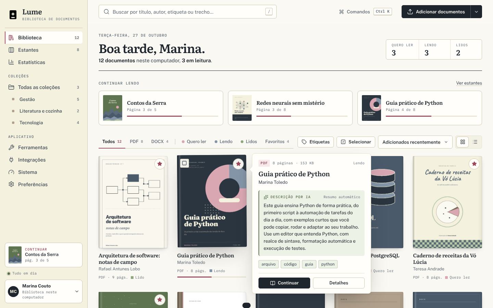
  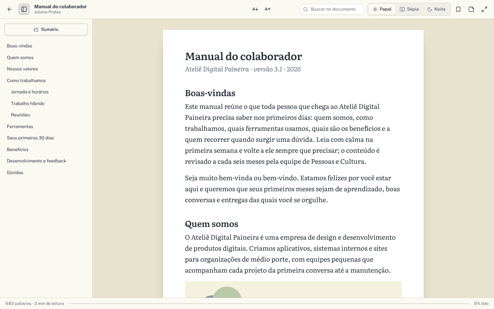
</p>

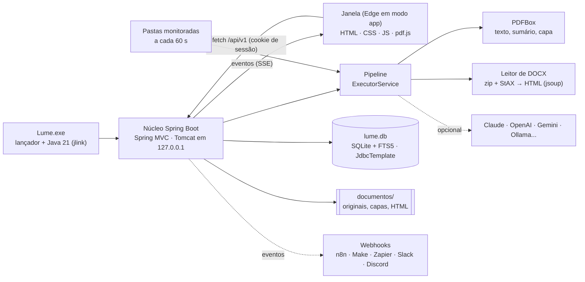

É a versão desktop do [Lume Web](https://github.com/Violet-pixel/Document-Library-Platform), agora com o núcleo em **Java 21 + Spring Boot 4**: a mesma interface e as mesmas regras, com o Django virando controladores Spring MVC, o WebSocket virando Server-Sent Events, o PostgreSQL e o Redis dando lugar ao SQLite (JdbcTemplate) e a uma fila em memória com `ExecutorService`, e o processador Java (PDFBox) de volta ao centro, lendo PDFs e desenhando as capas. A janela é o Microsoft Edge em modo aplicativo (o mesmo Chromium que vinha no Electron, já presente no Windows 10/11), com perfil próprio e sem barra de endereço.

O servidor só atende `127.0.0.1`: a janela entra com uma chave de uso único e recebe um cookie de sessão (HttpOnly, SameSite=Strict); sem ele, a API responde 401. O Host e a origem dos pedidos são conferidos.

| Etapa | O que acontece |
| --- | --- |
| Importação | Cópia para a biblioteca com SHA-256, tipo conferido pelo conteúdo, documento criado como *na fila* |
| Leitura | PDF: texto por página, sumário, metadados e capa (PDFBox). DOCX: HTML de leitura higienizado (jsoup), imagens, sumário e capa tipográfica |
| Descrição | Resumo e etiquetas pelo provedor escolhido; se ele falhar, o resumo local assume e o motivo fica registrado |
| Pronto | Índice de busca atualizado e a tela muda sozinha |

Falhas passageiras tentam de novo (5 s, 15 s, 45 s); arquivos protegidos por senha ou corrompidos falham na hora com a explicação. O que ficou pela metade quando o Lume foi fechado volta para a fila na próxima abertura.

### API local

A janela conversa com o núcleo por `http://127.0.0.1:<porta>/api/v1` (a porta muda a cada abertura e a API exige o cookie de sessão). Principais rotas:

| Rota | O que faz |
| --- | --- |
| `GET /documents` · `GET/PATCH/DELETE /documents/{id}` | Lista (busca, filtros, ordenação, páginas), detalhes, edição e exclusão |
| `POST /documents/batch` | Ações em lote: estante, favoritos, etiquetas, coleções, reprocessar, descrever, excluir |
| `POST /documents/{id}/ask` · `GET /documents/{id}/related` | Pergunte ao documento · documentos parecidos |
| `GET/PATCH /documents/{id}/reading` · `/annotations` | Progresso, estante, favoritos, destaques, notas e marcadores |
| `GET /collections` · `/collections/{id}/documents` · `/order` | Coleções e a ordem dos documentos |
| `GET /stats` · `GET /insights` · `GET /system` | Painel da biblioteca, Estatísticas e tela Sistema |
| `POST /tools/backup` · `GET /tools/export/catalog` · `POST /tools/export/markdown-folder` · `POST /tools/maintenance` | Ferramentas |
| `GET /integrations` · `/integrations/watch-folders` · `/integrations/webhooks` | Pastas monitoradas e webhooks |
| `GET/PUT /settings/ai` · `POST /settings/ai/test` | Provedor de IA |
| `GET /events` | Eventos ao vivo (Server-Sent Events) |

### Como contribuir

1. Abra uma issue descrevendo a ideia ou o problema.
2. Crie uma branch a partir da `main` e envie um pull request.
3. Quando a mudança for feita em dupla, inclua a linha `Co-authored-by:` no commit para que as duas pessoas recebam o crédito.
4. A mensagem do commit de uma versão é o próprio número da versão (por exemplo, `2.1.0`), o mesmo do arquivo `VERSION`.

## Desenvolvimento

Requisitos: JDK 21, Maven 3.9 e Git (Node.js 22+ só para o teste de interface; NSIS só para gerar o `.exe`).

```bash
git clone https://github.com/ravelroot/Document-Library-Desktop.git
cd Document-Library-Desktop
mvn test                                  # 53 testes JUnit (banco, busca, pipeline, API, DOCX, PDF, IA, ferramentas, integrações...)
mvn spring-boot:run                       # abre o Lume a partir do código
mvn spring-boot:run -Dspring-boot.run.arguments=--sem-janela   # só o servidor (mostra o endereço de entrada)
mvn -q package dependency:copy-dependencies -DincludeScope=runtime -DoutputDirectory=target/lib
npm --prefix e2e install && npm --prefix e2e test               # abre a interface no Chromium e percorre todas as telas
npm --prefix e2e test -- --prints                               # também refaz os prints de docs/images
pip install weasyprint==70.0 && python docs/fonte/gerar_pdfs.py # refaz os dois PDFs a partir de docs/fonte
bash scripts/empacotar-windows.sh         # gera o Lume.exe portátil (jlink + NSIS) e copia para a raiz
```

### Estrutura

```text
Lume.exe                         executável portátil para Windows (Java embutido)
pom.xml                          Maven: Spring Boot 4, PDFBox, sqlite-jdbc, jsoup, JNA
src/main/java/io/github/ravelroot/lume/
  LumeApplication.java           início: pasta de dados, instância única, servidor e janela
  core/  db/  events/            utilitários, SQLite + migrações, eventos
  library/  pipeline/            biblioteca, busca FTS5, coleções, anotações, lotes, fila de processamento
  processing/  docx/  ai/        PDFBox e capas, leitor de DOCX, descrição e perguntas por IA
  tools/  integrations/          backup, exportações, estatísticas e manutenção; pastas monitoradas e webhooks
  web/  desktop/                 API REST, SSE, sessão; janela, diálogos e integração com o Windows
src/main/resources/static/       interface (módulos ES, sem build), pdf.js 5, fontes e ícones
  js/palette.js  js/actions.js   paleta de comandos (Ctrl+K) e ações compartilhadas
  js/pages/                      biblioteca, documento, leitor, estantes, coleções, estatísticas,
                                 ferramentas, integrações, sistema e preferências
src/test/java/                   JUnit 6 + Spring Boot Test
e2e/                             teste de interface com Playwright
packaging/windows/  scripts/     lançador NSIS e empacotamento (jlink)
exemplos/                        12 documentos fictícios
docs/                            manuais em PDF, fontes HTML dos manuais (docs/fonte) e imagens do README
.github/workflows/               CI (testes, interface e Lume.exe) e atividade diária
```

## Parceria

O Lume é um projeto desenvolvido em parceria por Erik Pimenta ([@ravelroot](https://github.com/ravelroot)) e Clara Portes ([@Violet-pixel](https://github.com/Violet-pixel)).

A ideia surgiu da vontade de ter um lugar único para organizar, ler e anotar documentos, sem depender de vários aplicativos diferentes. Desde o início, o projeto foi pensado e construído a quatro mãos: das decisões de arquitetura e do pipeline de ingestão até o design do leitor e a identidade visual.

O repositório oficial fica na conta da Clara, em [Violet-pixel/Document-Library-Platform](https://github.com/Violet-pixel/Document-Library-Platform). A versão desktop, [Document-Library-Desktop](https://github.com/ravelroot/Document-Library-Desktop), segue a mesma parceria e reaproveita a base da versão web.

Sugestões, issues e pull requests são bem-vindos nos dois repositórios. Antes de abrir um, veja o [guia de contribuição](CONTRIBUTING.md).

### Componentes de terceiros

O Lume inclui ou depende de componentes com licenças próprias, que continuam valendo para cada um deles:

| Componente | Uso no projeto | Licença |
|---|---|---|
| [Spring Boot](https://spring.io/projects/spring-boot) / Spring Framework | Núcleo, API REST e injeção de dependências | Apache-2.0 |
| [Apache Tomcat](https://tomcat.apache.org/) | Servidor HTTP embutido (127.0.0.1) | Apache-2.0 |
| [Apache PDFBox](https://pdfbox.apache.org/) | Texto, sumário, metadados e capas dos PDFs | Apache-2.0 |
| [SQLite JDBC](https://github.com/xerial/sqlite-jdbc) | Banco local com busca FTS5 | Apache-2.0 |
| [jsoup](https://jsoup.org/) | Lista de permissões do HTML de leitura | MIT |
| [JNA](https://github.com/java-native-access/jna) | Cofre do Windows (DPAPI), registro e foco da janela | Apache-2.0 / LGPL-2.1 |
| [Jackson](https://github.com/FasterXML/jackson) | JSON da API | Apache-2.0 |
| [Eclipse Temurin](https://adoptium.net/) (OpenJDK) | Java embutido no Lume.exe | GPL-2.0 com Classpath Exception |
| [NSIS](https://nsis.sourceforge.io/) | Lançador portátil do Lume.exe | zlib |
| [pdf.js](https://github.com/mozilla/pdf.js) | Renderização de PDF no leitor | Apache-2.0 |
| [Lucide](https://lucide.dev/) | Ícones da interface | ISC |
| [Public Sans](https://public-sans.digital.gov/) | Fonte da interface | SIL Open Font License 1.1 |
| [IBM Plex Mono](https://github.com/IBM/plex) | Rótulos, números e código | SIL Open Font License 1.1 |
| [Literata](https://github.com/googlefonts/literata) | Fonte de leitura e das capas | SIL Open Font License 1.1 |
| [JUnit](https://junit.org/) / [Playwright](https://playwright.dev/) | Testes automatizados | EPL-2.0 / Apache-2.0 |

O Microsoft Edge (WebView2/Chromium) que desenha a janela já vem com o Windows e não é redistribuído pelo Lume.

Os documentos enviados pelos usuários (PDF e DOCX) pertencem aos seus respectivos autores e não são cobertos por esta licença.

## Licença

Copyright (©) 2026 Erik Pimenta & Clara Portes

Este projeto é distribuído sob a licença [MIT](LICENSE). Você pode usar, copiar, modificar e redistribuir o código, inclusive para fins comerciais, desde que mantenha o aviso de copyright e o texto da licença.


